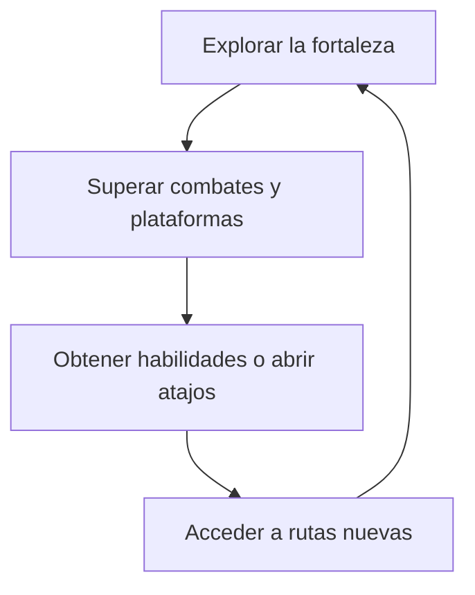

# Ecos de la Fortaleza - Documento de diseño (GDD)

**Hito:** 1 — Concepto  
**Versión del documento:** 0.1  
**Última actualización:** 16/10/2026  
**Estado:** diseño inicial, pendiente de prototipado.

> El título es provisional. La historia, los controles y los valores de equilibrio constituyen una propuesta inicial que se ajustará durante el desarrollo. Las mecánicas descritas son previstas, no una declaración de funcionalidades implementadas.

## 1. Ficha del juego

| | |
|---|---|
| Título | Ecos de la Fortaleza — provisional. |
| Autor/a | Alberto Rodríguez Domínguez. |
| Género | Plataformas de acción y exploración con estructura metroidvania. |
| 2D / 3D | 2D, con desplazamiento lateral. |
| Plataformas | Windows. |
| Versión de Unity y pipeline | Unity 6 - URP, plantilla Universal 2D. |
| Público objetivo y PEGI | Jugadores que disfrutan del combate cuerpo a cuerpo, los retos de plataformas y la exploración con desbloqueo de rutas. PEGI 12 orientativo por combate fantástico; no es una clasificación oficial. |
| Duración de una partida | Objetivo inicial: 15–25 minutos para completar el recorrido principal, sin contar reintentos. |
| Repositorio | [GitHub](https://github.com/albertorodriguezdam/Ecos-de-la-Fortaleza.git) |
| Página de itch.io | Pendiente de crear y añadir el enlace. |

## 2. Concepto

### Resumen

En este juego para un jugador, un aventurero entra en una fortaleza abandonada que ha sido ocupada por monstruos para derrotar al guardián que mantiene activa una antigua maldición. Durante el recorrido consigue doble salto y dash, habilidades que le permiten alcanzar plataformas, superar obstáculos y regresar a zonas conocidas para abrir nuevas rutas.

### Pilares de diseño

1. **Movimiento preciso:** los saltos y desplazamientos deben responder de forma predecible y permitir que el jugador mejore mediante la práctica.
2. **Exploración mediante habilidades:** el jugador encuentra accesos que todavía no puede superar y regresa a ellos después de conseguir una nueva capacidad de movimiento.
3. **Dificultad progresiva:** cada zona introduce un reto y posteriormente lo combina con mecánicas que el jugador ya conoce.
4. **Coherencia del escenario:** toda la fortaleza se construye con un único pack, Critters — Old Castle Tileset, manteniendo un lenguaje visual común.

### Referencias

- **Hollow Knight:** referencia principal para la exploración de espacios conectados, el combate lateral y la progresión mediante habilidades de movimiento.

### Qué lo hace diferente

La propuesta se concentra en explorar una fortaleza compacta cuyos caminos cambian de utilidad al conseguir nuevas habilidades. Su identidad estará en aprovechar la arquitectura del castillo: el doble salto abre recorridos elevados por las murallas y el dash permite cruzar pasos amplios y llegar a la torre final.

Las tres zonas comparten ambientación, pero se diferencian por su distribución, verticalidad, enemigos y obstáculos. Los atajos reducen los desplazamientos repetidos y conectan los nuevos recorridos con el patio de entrada.

El alcance se limita a tres zonas, dos habilidades desbloqueables, una selección reducida de enemigos y un jefe final.

## 3. Historia y ambientación

**Premisa**

En un mundo de fantasía medieval, una fortaleza que protegía los caminos de la región quedó abandonada tras un ritual fallido. Una maldición despertó a sus antiguos guardianes y atrajo a otras criaturas, que ahora ocupan sus murallas, galerías y torres.

La maldición permanece vinculada al guardián que habita en la torre principal. Para acabar con ella es necesario atravesar la fortaleza y derrotarlo.

**Protagonista y motivación**

El protagonista es un aventurero armado con una espada que entra en la fortaleza para eliminar la amenaza que se extiende hacia los caminos cercanos. Al principio dispone de movimiento, salto y ataque básicos.

Durante la exploración obtiene dos reliquias que otorgan doble salto y dash. Estas habilidades le permiten acceder a partes de la fortaleza que antes eran inalcanzables y avanzar hasta la torre.

El personaje se representará con Animated Pixel Adventurer, de rvros. Su nombre y la identidad concreta del jefe final quedan pendientes de definir.

**Espacios y tono**

La ambientación combinará piedra envejecida, estructuras de madera, decoración medieval y zonas ocupadas por monstruos. El tono será de aventura y peligro en un lugar deteriorado, con contraste suficiente para reconocer plataformas, enemigos y trampas.

El escenario utilizará únicamente Critters — Old Castle Tileset como pack de entorno. Sus piezas se reutilizarán para construir espacios con funciones diferentes, manteniendo la misma fortaleza como escenario común.

**Forma de contar la historia**

- Un texto inicial presenta la fortaleza, la maldición y el objetivo del aventurero.
- La decoración y la presencia de enemigos muestran el abandono y la ocupación del lugar.
- Los mensajes al obtener una reliquia explican su habilidad y sugieren cómo utilizarla.
- Un texto final comunica la ruptura de la maldición al derrotar al guardián.

La narración será breve, sin diálogos extensos ni cinemáticas complejas en el alcance inicial.

## 4. Jugabilidad

### Objetivo

Explorar las tres zonas conectadas de la fortaleza, obtener doble salto y dash, superar enemigos y trampas y derrotar al guardián de la torre principal.

### Bucle de juego

El jugador explora, supera combates y obstáculos, consigue una habilidad o abre un atajo y utiliza ese progreso para acceder a nuevos recorridos.

Las habilidades se obtienen en dos puntos concretos del recorrido; no se conceden por cada enemigo derrotado.

### Condiciones de victoria y derrota

- **Victoria:** derrotar al jefe final. Se muestra una pantalla con las opciones de volver a jugar y regresar al menú principal.
- **Derrota:** perder toda la salud. Se muestra una pantalla con las opciones de reintentar desde el último punto de control y regresar al menú principal.
- **Reintento:** el jugador recupera la salud y conserva las habilidades y los atajos desbloqueados durante esa partida. Los enemigos del tramo se restablecen. El jefe recupera toda su salud si se reinicia su combate.
- **Caída fuera del recorrido:** resta salud y devuelve al jugador a una posición segura. Si agota su salud, activa la derrota.

No habrá límite de tiempo ni un número limitado de reintentos. La persistencia del progreso entre sesiones se decidirá en un hito posterior.

### Progresión

Se proponen tres niveles diferenciados, cada uno en una escena de juego propia y con conexiones que permitan regresar a zonas anteriores:

| Zona provisional | Distribución y retos | Progresión y conexiones |
|---|---|---|
| 1. Patio y murallas | Recorridos principalmente horizontales, saltos sencillos y primeros enemigos terrestres. Enseña el ataque y la lectura de los peligros. | Se obtiene el doble salto tras superar un primer tramo. Desde el patio se ven una entrada elevada y un paso demasiado ancho para el salto básico. |
| 2. Galerías interiores | Recorridos verticales, plataformas elevadas, trampas y primeros enemigos voladores o con ataques a distancia. | Se accede por la entrada elevada usando doble salto. Se obtiene el dash y se abre un atajo de regreso al patio. |
| 3. Torre del guardián | Ascenso con saltos más exigentes, pasos amplios y combinaciones de enemigos y trampas. Termina en la sala del jefe. | Se accede desde el patio al superar el paso ancho con dash. Sus retos combinan las dos habilidades adquiridas. Derrotar al jefe completa la partida. |

El jugador volverá al patio después de conseguir el dash y utilizará la nueva habilidad en un obstáculo que ya había visto. Los atajos facilitarán ese regreso y evitarán repetir recorridos completos.

Las habilidades se presentarán primero en un espacio seguro y después se exigirán en situaciones con mayor riesgo. Los niveles deberán aportar retos nuevos, además de cambiar su distribución.

## 5. Mecánicas

Los controles de teclado son provisionales. Los parámetros se ajustarán durante el prototipado.

| Mecánica | Descripción | Control | Nivel en el que aparece |
|---|---|---|---|
| Movimiento horizontal | Desplazamiento a izquierda y derecha; el personaje mira en la dirección del movimiento. | A / D o flechas izquierda / derecha. | Zona 1, desde el inicio. |
| Salto | Impulso vertical desde el suelo, con control horizontal en el aire. | Espacio. | Zona 1, desde el inicio. |
| Ataque con espada | Ataque frontal de corto alcance. Solo causa daño durante la parte activa de la animación. | J. | Zona 1, desde el inicio. |
| Doble salto | Permite realizar un segundo salto en el aire después de obtener su reliquia. Se recupera al tocar suelo. | Espacio durante el salto. | Se desbloquea en la zona 1 y permite acceder a la zona 2. |
| Dash | Desplazamiento horizontal breve en la dirección hacia la que mira el personaje. Se puede realizar en suelo o en el aire. | Mayús izquierda. | Se desbloquea en la zona 2 y permite acceder a la zona 3. |
| Obtención de habilidades | Recoger una reliquia activa permanentemente su habilidad durante la partida. | Contacto con la reliquia. | Zonas 1 y 2. |
| Activación de atajos | Desde el otro lado de un acceso bloqueado se habilita un camino de regreso que permanece abierto durante la partida. | E junto al acceso indicado. | Desde la zona 2. |
| Salud y recepción de daño | Los ataques enemigos y las trampas reducen la salud. Tras recibir un impacto hay un breve periodo de invulnerabilidad. | Automático al recibir un impacto. | Desde el primer peligro de la zona 1. |
| Puntos de control | Guardan el lugar desde el que se reintentará el tramo tras una derrota. | Contacto con el punto de control. | Zonas 1, 2 y 3. |
| Trampas del castillo | Zonas peligrosas representadas con los recursos del pack de escenario. Causan daño por contacto y obligan a elegir una trayectoria segura. | Se superan con movimiento, salto, doble salto o dash. | Se presentan en la zona 1 y se combinan con otros retos en las zonas 2 y 3. |
| Combate contra el jefe | Enfrentamiento con ataques anunciados y ventanas para responder con la espada. Utiliza las habilidades aprendidas para cambiar de posición. | Combinación de ataque y movimiento. | Final de la zona 3. |

**Reglas iniciales de funcionamiento**

| Sistema | Regla propuesta para el prototipo |
|---|---|
| Salud del jugador | 5 puntos. Los impactos ordinarios, las trampas y las caídas restan 1 punto. |
| Daño de la espada | 1 punto por ataque acertado. Un mismo ataque no golpea varias veces al mismo enemigo. |
| Ritmo de ataque | Es necesario terminar un ataque antes de iniciar el siguiente; duración inicial aproximada de 0,35 segundos. |
| Invulnerabilidad tras daño | 0,8 segundos para evitar daños repetidos por un contacto continuado. |
| Doble salto | Un salto adicional por fase aérea. El dash no lo recarga. |
| Dash | Duración inicial de 0,15 segundos y recarga de 0,6 segundos. Solo se permite uno por fase aérea. Aterrizar lo habilita de nuevo, pero hay que completar también la recarga. |
| Protección durante el dash | No concede invulnerabilidad ni atraviesa paredes. Desplaza al personaje fuera del peligro, pero atravesar una trampa activa causa daño. |
| Compatibilidad de ataque y dash | No se puede iniciar un dash mientras el ataque esté activo ni atacar durante el dash. |
| Atajos | Una vez abiertos, permanecen accesibles al cambiar de zona o reintentar durante la misma partida. |
| Puntos de control | Activarlos recupera toda la salud. Habrá uno antes del enfrentamiento final. |

Estos valores son hipótesis iniciales, no resultados de pruebas. La velocidad de movimiento, la altura de salto, la distancia del dash y la salud de cada enemigo se concretarán al probarlos con las dimensiones del escenario.

Las separaciones que requieren dash se diseñarán para que no puedan superarse solo con doble salto. Las plataformas que enseñan doble salto deberán ser alcanzables sin necesitar una habilidad posterior.

**Combinación de mecánicas**

- **Exploración:** el doble salto abre el acceso elevado a las galerías. El dash permite regresar al patio y acceder al camino hacia la torre.
- **Plataformas:** las murallas enseñan los saltos básicos, las galerías introducen la verticalidad y la torre combina salto, doble salto y dash.
- **Combate:** el jugador se aproxima para atacar y se retira durante la respuesta del enemigo. Los enemigos voladores exigen ajustar la altura y el momento del ataque.
- **Trampas:** los peligros se colocan para exigir trayectorias seguras y uso de las habilidades, sin bloquear caminos necesarios para volver a un punto de control.
- **Atajos y reintentos:** los accesos abiertos y los puntos de control reducen el recorrido que hay que repetir tras una derrota.

## 6. Controles

Pendiente de desarrollar en el hito 2. Los controles de teclado previstos aparecen en el apartado 5, aunque no son definitivos.

| Acción | Teclado | Mando |
|--------|---------|-------|
| | | |

## 7. Niveles

Pendiente de desarrollar en el hito 4. La progresión inicial entre las tres zonas está descrita en el apartado 4.

### Nivel 1: Patio y murallas

Pendiente de concretar el mapa, la escena de Unity, la duración y el contenido opcional.

### Nivel 2: Galerías interiores

Pendiente de concretar el mapa, la escena de Unity, la duración y el contenido opcional.

### Nivel 3: Torre del guardián

Pendiente de concretar el mapa, la escena de Unity, la duración y el contenido opcional.

## 8. Personajes y enemigos

Pendiente de desarrollar en el hito 4. Se detallarán las características del protagonista, la selección de enemigos, sus comportamientos y el jefe final.

## 9. Interfaz y flujo de pantallas

Pendiente de desarrollar en el hito 3.

### Diagrama de flujo

Pendiente de representar las pantallas y las transiciones entre ellas.

### HUD

Pendiente de definir la distribución de la información durante la partida.

### Menús

Pendiente de describir el menú principal, la pausa, las opciones, los créditos y las pantallas de victoria y derrota.

## 10. Dirección de arte

El estilo previsto es pixel art de fantasía medieval, con una fortaleza deteriorada formada por murallas de piedra, galerías y torres. El escenario se construirá con Critters — Old Castle Tileset.

Se comprobarán juntos el protagonista, los enemigos y una sección del escenario. Old Castle tiene contornos marcados y una apariencia algo más colorida; se valorarán ajustes de paleta, contraste y escala aparente para que todos los elementos encajen. La legibilidad de plataformas, ataques y peligros tendrá prioridad.

**Pendiente para el hito 4:** concretar la paleta, las tipografías, el tablero de referencias y los ajustes necesarios para mantener la coherencia visual.

## 11. Sonido y música

Pendiente de desarrollar en el hito 4. Se seleccionarán música y efectos de sonido gratuitos con licencias compatibles, se registrarán sus usos y se documentará la organización del audio.

## 12. Efectos visuales y game feel

Pendiente de desarrollar en el hito 5. Se concretarán el comportamiento de la cámara, la iluminación, los efectos visuales y la respuesta de las acciones del jugador.

## 13. Recursos de terceros

El presupuesto de recursos es de 0 €. Todos los recursos se utilizarán en sus versiones gratuitas, sin depender de complementos de pago. La tabla recoge la selección prevista para el proyecto; su inclusión no acredita que ya estén descargados o integrados.

| Recurso | Tipo | Autor | Licencia | Enlace | Dónde se usa |
|---|---|---|---|---|---|
| Critters — Old Castle Tileset | Tiles, fondos, decoración, objetos animados y trampas. | David (chroma_dave), distribuido por Foozle. | CC0. Descarga gratuita con donación opcional. | [Página del recurso](https://foozlecc.itch.io/critters-old-castle) | Único pack de entorno para las tres zonas de la fortaleza. |
| Animated Pixel Adventurer | Sprites y animaciones. | rvros | Licencia propia: permite uso personal/comercial y modificación; prohíbe revender o redistribuir el asset. | [Página del recurso](https://rvros.itch.io/animated-pixel-hero) | Personaje principal. |
| Fire Worm | Sprites y animaciones. | LuizMelo | CC0. | [Página del recurso](https://luizmelo.itch.io/fire-worm) | Candidato a enemigo con ataque de fuego; presencia limitada a los tramos avanzados. |
| Monsters Creatures Fantasy 2 | Pack de sprites y animaciones. | LuizMelo | CC0. | [Página del recurso](https://luizmelo.itch.io/monsters-creatures-fantasy-2) | Selección de enemigos terrestres o voladores; criaturas concretas pendientes. |
| Monsters Creatures Fantasy | Pack de sprites y animaciones. | LuizMelo | CC0. | [Página del recurso](https://luizmelo.itch.io/monsters-creatures-fantasy) | Selección de enemigos básicos; criaturas concretas pendientes. |
| Evil Wizard | Sprites y animaciones. | LuizMelo | CC0. | [Página del recurso](https://luizmelo.itch.io/evil-wizard) | Candidato a enemigo avanzado. Su selección no implica que sea el jefe final. |

Se importarán únicamente los elementos que vayan a utilizarse. No se prevé implementar todas las criaturas de los packs disponibles.

**Referencia opcional fuera del alcance inicial:** [Fire Totem (Free), de CreativeKind](https://creativekind.itch.io/fire-totem-free). Su incorporación se decidirá más adelante; el diseño base del escenario y sus trampas se resolverá con Old Castle. Su licencia propia permite uso y modificación, pero restringe la redistribución del asset.

**Selecciones pendientes:** recurso gráfico del jefe final, representación de las reliquias y los puntos de control, interfaz, tipografías, música y efectos de sonido. Primero se comprobará qué objetos del pack pueden representar los elementos interactivos previstos. Cualquier recurso adicional se registrará aquí.

**Modificaciones:** no se ha realizado ninguna modificación de los assets en esta preparación del documento. Los cambios posteriores de color, recorte o animación se registrarán aquí.

**Licencias y publicación:** Old Castle está publicado bajo CC0, que permite modificar y distribuir sus archivos, también en el repositorio. La licencia de rvros contiene restricciones de redistribución: antes de publicar sus archivos fuente en un repositorio público debe aclararse ese permiso o seleccionarse una alternativa compatible. Si se incorpora Fire Totem, se revisará igualmente su restricción. Todos los recursos utilizados aparecerán en los créditos del juego y en este documento.

## 14. Declaración de uso de IA

| Herramienta | Uso en la preparación de este hito |
|---|---|
| ChatGPT | Organización de requisitos, redacción y revisión del GDD, búsqueda de recursos y adaptación a la plantilla del profesor. |

- No se han generado recursos gráficos del juego, música, efectos de sonido ni efectos visuales mediante IA en esta preparación.
- La página de Old Castle declara que no se ha utilizado IA generativa en su creación.
- La declaración se actualizará para registrar los usos posteriores de IA y los cambios realizados sobre sus propuestas.

## 15. Aspectos técnicos

Pendiente de desarrollar en el hito 3. Se documentarán la estructura de carpetas y escenas, las responsabilidades de los scripts, los paquetes utilizados, el guardado de datos y los problemas técnicos encontrados.

## 16. Diario de desarrollo

### 2026-10-16

- Se ha definido un plataformas-metroidvania 2D con combate, doble salto y dash desbloqueables.
- Se han consultado el enunciado del proyecto y la estructura del GDD.
- Se ha reorganizado el documento según la plantilla del profesor, conservando sus 18 apartados, sus tablas y sus subapartados; se han señalado las secciones pendientes de hitos posteriores.
- Se han reunido recursos gratuitos para el protagonista y los enemigos.
- Se ha elegido Critters — Old Castle Tileset como referencia y único pack previsto para los escenarios.
- Se ha adaptado la ambientación a una fortaleza abandonada, con patio y murallas, galerías interiores y torre del guardián.
- Se han mantenido los dos desbloqueos de movimiento y se ha concretado el regreso al patio para abrir nuevas rutas.
- Se ha retirado la dependencia de trampas de fuego del diseño base; Fire Totem queda como recurso opcional.
- Este registro describe trabajo de documentación. Su incorporación y commit en el repositorio están pendientes; no se ha comprobado la implementación del juego.

## 17. Pruebas con jugadores

Pendiente de realizar en el hito 5. Se registrarán al menos tres pruebas con jugadores, la versión probada, las observaciones y los cambios aplicados a partir de sus resultados.

## 18. Postmortem

Pendiente de redactar al finalizar el proyecto, en el hito 6. Se valorarán los resultados, las dificultades, las diferencias respecto al diseño inicial y los aprendizajes.

---

